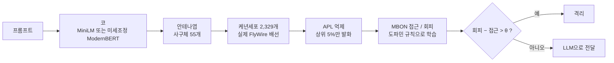

# FlyGuard 학습 방식과 과적합 점검

**초파리 뇌 자체는 파인튜닝하지 않았어요.**
- 배선(투사뉴런 → 케년세포)은 실제 FlyWire 커넥톰 그대로 고정이에요.
- 초파리가 배우는 건 출력 시냅스(케년세포 → MBON)의 세기뿐이에요. 이것도 경사하강법이 아니라, 어떤 케년세포가 어떤 문장에 켜졌는지 세는 "도파민 규칙"이에요.
- 미분으로 학습(파인튜닝)한 건 "코" 역할의 ModernBERT뿐이에요(하이브리드).

이 데이터셋 안에서는 심한 과적합 징후가 없어요. 하지만 다른 종류의 프롬프트로 일반화되는지는 아직 확인하지 않았어요. 아래 숫자는 모두 [`reports/results.md`](../reports/results.md)에서 가져왔어요.

## 1. 전체 흐름



## 2. 부분별로 무엇을 학습했나

| 부분 | 학습 여부 | 방법 |
|---|---|---|
| 코: 고정 MiniLM | 안 함 | 공개 사전학습 모델(`all-MiniLM-L6-v2`) 그대로 |
| 코: 미세조정 ModernBERT (하이브리드) | **파인튜닝** | 4절 참고 |
| 안테나엽 (임베딩 → 사구체 55개) | 정답 없이 맞춤 | PCA 28개 방향 → ON/OFF 분리(56채널) → 사구체 55개에 무작위 배정 |
| 투사뉴런 → 케년세포 배선 | **고정** | 실제 FlyWire v783, 오른쪽 반구, 시냅스 5개 이상인 연결(케년세포 2,329개) |
| APL 억제 | 고정 규칙 | 가장 강하게 자극된 케년세포 5%(약 116개)만 발화 |
| 케년세포 → MBON 시냅스 세기 | **도파민 규칙** | 3절 참고(경사하강법 아님) |
| β(도파민 세기), θ(판정 기준) | validation으로 선택 | 값 2개, 확률 표시용 Platt 보정 |

## 3. 초파리 뇌가 배우는 방식: 도파민 규칙

실제 초파리 버섯체의 학습 원리(Aso et al., eLife 2014)를 따랐어요.

1. 학습 문장 하나를 넣으면 케년세포 2,329개 중 약 116개(5%)가 켜져요.
2. 인젝션 문장이면 "처벌 도파민"(PPL1)이 나와요. 켜진 케년세포에서 **접근 MBON**으로 가는 시냅스가 약해져요.
3. 정상 문장이면 "보상 도파민"(PAM)이 나와요. 켜진 케년세포에서 **회피 MBON**으로 가는 시냅스가 약해져요.
4. 실제 구현은 케년세포 k마다 켜진 횟수를 세는 것뿐이에요.
   - 인젝션 문장에서 켜진 횟수 n_inj(k), 정상 문장에서 켜진 횟수 n_ben(k)
   - 시냅스 세기:
     - w_접근(k) = exp(−β · n_inj(k) / N_inj)
     - w_회피(k) = exp(−β · n_ben(k) / N_ben)
5. 새 문장이 들어오면 켜진 케년세포들의 평균 세기로 판정해요.
   - 회피 − 접근 > θ 이면 격리, 아니면 LLM으로 전달
   - β는 {5, 10, 20, 50, 100, 200, 500} 중 validation AUC가 가장 높은 값이에요.
   - θ는 validation 정확도가 가장 높은 값이에요.

미분도 반복 학습(에폭)도 없어요. train을 한 번 훑으면 끝나요. 횟수만 세기 때문에 한 문장씩 배우는 것(`partial_fit`)과 한 번에 배우는 것(`fit`)의 결과가 정확히 같아요. 코드는 [`flyguard/mushroom_body.py`](../flyguard/mushroom_body.py)에 있어요.

## 4. 하이브리드: 코를 미세조정한 방법 (교차 적합)

| 단계 | 내용 |
|---|---|
| 나누기 | train 11,046문장을 정답 비율을 유지하며 5묶음(폴드)으로 나눠요. |
| 코 미세조정 | 폴드마다 ModernBERT-base를 **나머지 4묶음(약 8,800문장)**으로 미세조정해요. 설정은 아래 목록에 있어요. |
| 초파리 학습 | 그 폴드의 안테나엽(PCA)과 도파민 횟수는 **그 ModernBERT가 한 번도 못 본 1묶음(약 2,200문장)**으로만 배워요. |
| 판정 | 새 문장은 폴드 5개의 확률을 평균해요. 평균에 쓰는 기준값은 validation으로 골라요. |

- ModernBERT 미세조정 설정
  - 3에폭, AdamW, 학습률 5e-5, 웜업 10%, 배치 32, 최대 256토큰, bf16
  - validation 정확도가 가장 좋은 에폭을 저장해요.

**교차 적합을 쓴 이유:** 미세조정한 모델은 자기가 학습한 문장을 지나치게 잘 구별해요. 같은 문장으로 초파리가 횟수를 세면 초파리가 "다 쉽다"고 착각해서 과신하게 돼요. 교차 적합은 이 누수를 막는 장치예요. 코드는 [`flyguard/hybrid.py`](../flyguard/hybrid.py)에 있어요.

## 5. 과적합 점검

| 모델 | validation | test | test-clean |
|---|---|---|---|
| 하이브리드 (미세조정 ModernBERT 코 + 초파리) | 99.1% | 97.4% | 97.4% |
| ModernBERT 1개 | 98.2% | 96.2% | 96.2% |
| TF-IDF + 로지스틱 회귀 | 97.7% | 96.1% | 96.2% |
| 초파리 (고정 MiniLM 코, 시드 5개 평균) | 93.9% | 91.6% | 91.6% |

- **모든 모델이 validation에서 test로 갈 때 1.5~2.5%p 비슷하게 떨어져요.**
  - 초파리나 하이브리드만 유독 떨어진 게 아니에요.
  - 설정을 validation으로 골라서 validation 점수가 부풀었고, 두 세트의 문장도 조금 달라요. 정직한 성적은 test 숫자예요.
- **test로는 아무것도 조정하지 않았어요.**
  - 모든 선택은 validation으로 했어요.
  - test 채점은 4번 했지만 설정은 그대로였어요. 기록은 [`reports/runs.jsonl`](../reports/runs.jsonl)에 있어요.
- **test-clean도 점수가 같아요.** validation과 겹치는 116문장을 뺀 1,985문장의 결과라서, 겹침 때문에 점수가 부풀지 않았다는 뜻이에요.
- **초파리 판정 방식은 과적합할 여지가 거의 없어요.**
  - 조정값이 β, θ 두 개뿐이고, 나머지는 횟수 세기예요.
  - 오히려 더 유연한 방식(케년세포 발화에 로지스틱 회귀)이 test 87.9%로 도파민 규칙(91.6%)보다 낮았어요. 과적합한 쪽은 유연한 방식이었어요.
- **학습 문장을 늘릴수록 성능이 꾸준히 올라요.** 50개 91.7% → 200개 93.7% → 1,000개 94.2% → 11,046개 95.0%(validation, 무작위 배선)
- **데이터 정리:** train에서 중복, 정답이 엇갈리는 문장, validation이나 test와 겹치는 문장을 뺐어요(11,089 → 11,046문장).

## 6. 남은 위험

- **이 데이터셋 밖에서도 잘 될지 아직 몰라요.**
  - 이 데이터셋에는 비슷한 패턴의 문장이 많아요.
  - 실제 서비스 프롬프트, 한국어, 새로운 공격 기법에서도 97%가 나온다는 보장은 없어요.
  - 다른 공개 데이터셋(예: `deepset/prompt-injections`)을 다시 학습하지 않고 넣어 보면 확인할 수 있어요.
- **과적합 위험은 초파리보다 ModernBERT 쪽이 커요.**
  - 1억 개가 넘는 파라미터를 이 데이터에 맞췄어요.
  - 교차 적합은 그 영향이 초파리로 새는 걸 막을 뿐이에요. 코 자체가 이 데이터셋에 맞춰진 건 그대로예요.
- **train에만 있는 길이 지름길이 있어요.**
  - 문장 길이 같은 겉모양만 써도 train 교차검증에서 69%를 맞혀요. validation에서는 52%(찍기 수준)예요.
  - 모델이 이런 단서에 얼마나 기대는지 따로 점검해 볼 만해요.
- **알려진 오답:** 데이터셋이 정상으로 분류한 "What are your limitations?"를 하이브리드는 폴드 3 대 2로 격리해요.

## 재현 방법

```bash
python -m flyguard.data
python -m flyguard.connectome
python -m flyguard.train_encoder
python -m flyguard.hybrid train
python -m flyguard.build
python -m flyguard.evaluate --final
```

각 명령이 하는 일
- `python -m flyguard.data`: 데이터를 받고 정리해요.
- `python -m flyguard.connectome`: 실제 FlyWire 배선을 만들어요.
- `python -m flyguard.train_encoder`: ModernBERT 1개를 미세조정해요(비교용).
- `python -m flyguard.hybrid train`: 하이브리드를 학습해요(폴드 5개 교차 적합).
- `python -m flyguard.build`: 웹 데모용 초파리를 만들어요(고정 MiniLM 코).
- `python -m flyguard.evaluate --final`: 결과표를 만들어요. test 채점은 기록에 남아요.

## 참고 문헌
- Aso et al., *eLife* 2014. 버섯체 구획과 도파민에 의한 연합 학습
- Dorkenwald et al. / Schlegel et al., *Nature* 2024. FlyWire 전뇌 커넥톰과 세포 유형 주석
- Caron et al., *Nature* 2013. 투사뉴런 → 케년세포 연결의 무작위성
- Dasgupta, Stevens & Navlakha, *Science* 2017. 초파리 후각 회로를 본뜬 해싱(FlyHash)
