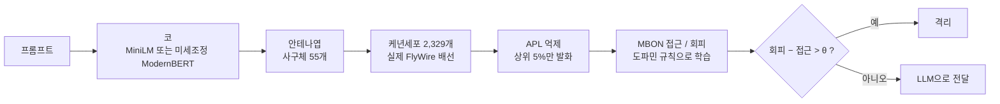

# FlyGuard 학습 방식과 과적합 점검

> **처음 읽는 분께:** 처음 보는 용어가 많다면 맨 아래 [용어 풀이](#용어-풀이)를 먼저 훑어보세요. 각 절 끝의 "쉽게 말하면"에 같은 내용을 쉬운 말로 다시 적었어요.

**초파리 뇌 자체는 파인튜닝하지 않았어요.**
- 배선(투사뉴런 → 케년세포)은 실제 FlyWire 커넥톰 그대로 고정이에요.
- 초파리가 배우는 건 출력 시냅스(케년세포 → MBON)의 세기뿐이에요. 이것도 경사하강법이 아니라, 어떤 케년세포가 어떤 문장에 켜졌는지 세는 "도파민 규칙"이에요.
- 미분으로 학습(파인튜닝)한 건 "코" 역할의 ModernBERT뿐이에요(하이브리드).

이 데이터셋 안에서는 심한 과적합 징후가 없어요. 하지만 다른 종류의 프롬프트로 일반화되는지는 아직 확인하지 않았어요. 아래 숫자는 모두 [`reports/results.md`](../reports/results.md)에서 가져왔어요.

> **쉽게 말하면**
> - 초파리 뇌의 "전선 연결"은 실제 초파리에서 그대로 가져왔고, 손대지 않았어요.
> - 초파리가 배우는 건 "이런 냄새(문장)일 때 다가갈까, 피할까"라는 기억뿐이에요. 그 기억도 복잡한 계산 없이, 각 신경세포가 어떤 문장에서 몇 번 켜졌는지 세어서 만들어요.
> - 복잡한 AI 학습(파인튜닝)은 문장을 숫자로 바꿔 주는 "코"(ModernBERT)에만 했어요.
> - 이 데이터셋 안에서는 "기출문제만 외운" 흔적(과적합)이 거의 없어요. 다만 전혀 다른 곳에서 가져온 문장으로는 아직 시험해 보지 않았어요.

## 1. 전체 흐름



> **쉽게 말하면:** 문장 하나가 들어오면 아래 순서로 판정해요.
> 1. **코:** 문장을 숫자 목록(임베딩)으로 바꿔요. 사람의 코가 냄새 분자를 신호로 바꾸는 것과 비슷해요.
> 2. **안테나엽:** 그 숫자들을 55개의 "냄새 채널"(사구체)로 정리해요.
> 3. **케년세포:** 신호가 실제 초파리 뇌의 연결을 따라 2,329개 세포로 퍼져요.
> 4. **APL 억제:** 그중 가장 세게 반응한 5%(약 116개)만 켜져요. 나머지는 조용히 시켜요.
> 5. **MBON:** 켜진 세포들이 "다가가자"(접근)와 "피하자"(회피) 두 출력 세포에 표를 던져요.
> 6. **판정:** "피하자" 쪽이 기준선(θ)보다 크게 이기면 격리하고, 아니면 LLM으로 보내요.

## 2. 부분별로 무엇을 학습했나

| 부분 | 학습 여부 | 방법 |
|---|---|---|
| 코: 고정 MiniLM | 안 함 | 공개 사전학습 모델(`all-MiniLM-L6-v2`) 그대로 |
| 코: 미세조정 ModernBERT (하이브리드) | **파인튜닝** | 4절 참고 |
| 안테나엽 (임베딩 → 사구체 55개) | 정답 없이 맞춤 | PCA 28개 방향 → ON/OFF 분리(56채널) → 사구체 55개에 무작위 배정 |
| 투사뉴런 → 케년세포 배선 | **고정** | 실제 FlyWire v783, 오른쪽 반구, 시냅스 5개 이상인 연결(케년세포 2,329개) |
| APL 억제 | 고정 규칙 | 가장 강하게 자극된 케년세포 5%(약 116개)만 발화 |
| 케년세포 → MBON 시냅스 세기 | **도파민 규칙** | 3절 참고(경사하강법 아님) |
| β(도파민 세기), θ(판정 기준) | validation으로 선택 | 값 2개, 확률 표시용 Platt 보정 |

> **쉽게 말하면:** 표의 각 줄을 풀어 쓰면 이래요.
> - **고정 MiniLM 코:** 남이 이미 만들어 둔 문장 이해 모델을 그대로 빌려 썼어요. 우리가 따로 가르치지 않았어요.
> - **미세조정 ModernBERT 코:** 더 똑똑한 문장 이해 모델을, 우리 문제(정상과 인젝션 구분)에 맞게 추가로 가르쳤어요.
> - **안테나엽:** 수백 개의 숫자를 정보를 최대한 살리면서 28개로 요약(PCA)해요. 그다음 + 값과 − 값을 다른 채널로 나눠 55개 채널에 나눠 담아요. 정답(정상/인젝션)은 보지 않고 숫자의 퍼진 모양만 보고 맞춰요.
> - **배선:** 어느 채널이 어느 케년세포로 연결되는지는 실제 초파리 뇌 지도를 그대로 썼어요. 연결이 약한 것(시냅스 5개 미만)은 뺐어요.
> - **APL 억제:** "가장 크게 반응한 5%만 말해"라는 고정 규칙이에요. 배우는 것이 없어요.
> - **케년세포 → MBON:** 초파리가 실제로 배우는 유일한 부분이에요.
> - **β와 θ:** 사람이 정해야 하는 손잡이 두 개예요. 모의고사(validation) 점수가 가장 좋은 값으로 골랐어요.

## 3. 초파리 뇌가 배우는 방식: 도파민 규칙

실제 초파리 버섯체의 학습 원리(Aso et al., eLife 2014)를 따랐어요.

1. 학습 문장 하나를 넣으면 케년세포 2,329개 중 약 116개(5%)가 켜져요.
2. 인젝션 문장이면 "처벌 도파민"(PPL1)이 나와요. 켜진 케년세포에서 **접근 MBON**으로 가는 시냅스가 약해져요.
3. 정상 문장이면 "보상 도파민"(PAM)이 나와요. 켜진 케년세포에서 **회피 MBON**으로 가는 시냅스가 약해져요.
4. 실제 구현은 케년세포 k마다 켜진 횟수를 세는 것뿐이에요.
   - 인젝션 문장에서 켜진 횟수 n_inj(k), 정상 문장에서 켜진 횟수 n_ben(k)
   - 시냅스 세기:
     - w_접근(k) = exp(−β · n_inj(k) / N_inj)
     - w_회피(k) = exp(−β · n_ben(k) / N_ben)
5. 새 문장이 들어오면 켜진 케년세포들의 평균 세기로 판정해요.
   - 회피 − 접근 > θ 이면 격리, 아니면 LLM으로 전달
   - β는 {5, 10, 20, 50, 100, 200, 500} 중 validation AUC가 가장 높은 값이에요.
   - θ는 validation 정확도가 가장 높은 값이에요.

미분도 반복 학습(에폭)도 없어요. train을 한 번 훑으면 끝나요. 횟수만 세기 때문에 한 문장씩 배우는 것(`partial_fit`)과 한 번에 배우는 것(`fit`)의 결과가 정확히 같아요. 코드는 [`flyguard/mushroom_body.py`](../flyguard/mushroom_body.py)에 있어요.

> **쉽게 말하면:** 케년세포마다 "출석부"가 하나씩 있다고 생각하면 돼요.
> - 학습 문장을 하나 볼 때마다, 그 문장에 켜진 세포의 출석부에 "정상 문장에서 켜짐" 또는 "인젝션 문장에서 켜짐"을 한 줄 적어요.
> - 다 적고 나면 이렇게 돼요.
>   - 인젝션 문장에서 자주 켜진 세포는 "다가가자" 목소리가 작아져요. 위험한 냄새를 맡으면 다가가지 않게 돼요.
>   - 정상 문장에서 자주 켜진 세포는 "피하자" 목소리가 작아져요. 안전한 냄새에서는 피하지 않게 돼요.
> - 식에 있는 exp(−β × 비율)은 "많이 켜졌을수록 목소리를 더 많이 줄인다"는 뜻이에요. β가 클수록 더 세게 줄여요.
> - 새 문장이 오면 켜진 세포들의 남은 목소리를 모아요. "피하자"가 기준선 θ보다 크게 이기면 격리해요.
> - 출석부를 세는 것뿐이라, 문장을 하나씩 보여 주든 한꺼번에 보여 주든 결과가 똑같아요.

## 4. 하이브리드: 코를 미세조정한 방법 (교차 적합)

| 단계 | 내용 |
|---|---|
| 나누기 | train 11,046문장을 정답 비율을 유지하며 5묶음(폴드)으로 나눠요. |
| 코 미세조정 | 폴드마다 ModernBERT-base를 **나머지 4묶음(약 8,800문장)**으로 미세조정해요. 설정은 아래 목록에 있어요. |
| 초파리 학습 | 그 폴드의 안테나엽(PCA)과 도파민 횟수는 **그 ModernBERT가 한 번도 못 본 1묶음(약 2,200문장)**으로만 배워요. |
| 판정 | 새 문장은 폴드 5개의 확률을 평균해요. 평균에 쓰는 기준값은 validation으로 골라요. |

- ModernBERT 미세조정 설정
  - 3에폭, AdamW, 학습률 5e-5, 웜업 10%, 배치 32, 최대 256토큰, bf16
  - validation 정확도가 가장 좋은 에폭을 저장해요.

**교차 적합을 쓴 이유:** 미세조정한 모델은 자기가 학습한 문장을 지나치게 잘 구별해요. 같은 문장으로 초파리가 횟수를 세면 초파리가 "다 쉽다"고 착각해서 과신하게 돼요. 교차 적합은 이 누수를 막는 장치예요. 코드는 [`flyguard/hybrid.py`](../flyguard/hybrid.py)에 있어요.

> **쉽게 말하면:** 시험공부에 비유하면 이래요.
> - **문제:** "코"(ModernBERT)가 공부한 문제를 초파리가 다시 보면, 코가 이미 답을 외우고 있어서 신호가 너무 또렷해요. 그러면 초파리는 "인젝션 구분은 쉽구나" 하고 착각해요. 실제 처음 보는 문장에서는 그렇게 쉽지 않은데도요.
> - **해결:**
>   1. 학습 문장을 5묶음으로 나눠요.
>   2. 코는 4묶음으로 공부해요.
>   3. 초파리는 코가 한 번도 못 본 나머지 1묶음으로만 감각을 익혀요.
>   4. 이걸 묶음을 바꿔 가며 5번 해서 코와 초파리 짝을 5세트 만들어요.
> - **판정:** 새 문장은 5세트가 각자 낸 "인젝션일 확률"을 평균해서 정해요. 한 세트만 쓰는 것보다 실수가 줄어요.
> - **설정 값:** 3에폭은 공부 자료를 처음부터 끝까지 3번 본다는 뜻이에요. 나머지 설정(학습률 등)은 맨 아래 용어 풀이를 보세요.

## 5. 과적합 점검

| 모델 | validation | test | test-clean |
|---|---|---|---|
| 하이브리드 (미세조정 ModernBERT 코 + 초파리) | 99.1% | 97.4% | 97.4% |
| ModernBERT 1개 | 98.2% | 96.2% | 96.2% |
| TF-IDF + 로지스틱 회귀 | 97.7% | 96.1% | 96.2% |
| 초파리 (고정 MiniLM 코, 시드 5개 평균) | 93.9% | 91.6% | 91.6% |

- **모든 모델이 validation에서 test로 갈 때 1.5~2.5%p 비슷하게 떨어져요.**
  - 초파리나 하이브리드만 유독 떨어진 게 아니에요.
  - 설정을 validation으로 골라서 validation 점수가 부풀었고, 두 세트의 문장도 조금 달라요. 정직한 성적은 test 숫자예요.
- **test로는 아무것도 조정하지 않았어요.**
  - 모든 선택은 validation으로 했어요.
  - test 채점은 4번 했지만 설정은 그대로였어요. 기록은 [`reports/runs.jsonl`](../reports/runs.jsonl)에 있어요.
- **test-clean도 점수가 같아요.** validation과 겹치는 116문장을 뺀 1,985문장의 결과라서, 겹침 때문에 점수가 부풀지 않았다는 뜻이에요.
- **초파리 판정 방식은 과적합할 여지가 거의 없어요.**
  - 조정값이 β, θ 두 개뿐이고, 나머지는 횟수 세기예요.
  - 오히려 더 유연한 방식(케년세포 발화에 로지스틱 회귀)이 test 87.9%로 도파민 규칙(91.6%)보다 낮았어요. 과적합한 쪽은 유연한 방식이었어요.
- **학습 문장을 늘릴수록 성능이 꾸준히 올라요.** 50개 91.7% → 200개 93.7% → 1,000개 94.2% → 11,046개 95.0%(validation, 무작위 배선)
- **데이터 정리:** train에서 중복, 정답이 엇갈리는 문장, validation이나 test와 겹치는 문장을 뺐어요(11,089 → 11,046문장).

> **쉽게 말하면**
> - **과적합이란:** 공부한 문제(train)만 달달 외워서, 조금만 다른 새 문제가 나오면 못 푸는 상태예요.
> - **표 읽는 법**
>   - validation은 "모의고사"예요. 설정을 고를 때 썼어요.
>   - test는 "본시험"이에요. 마지막에 성적만 쟀어요.
>   - test-clean은 본시험에서 모의고사와 똑같은 문제를 뺀 것이에요.
> - **과적합이 아니라고 보는 이유**
>   1. 모의고사보다 본시험 점수가 조금 낮은 건 모든 모델이 똑같아요. 모의고사로 설정을 골랐으니 모의고사 점수가 조금 부푸는 건 자연스러워요.
>   2. 본시험 문제로는 아무것도 고치지 않았어요. 성적을 4번 쟀지만 설정은 그대로였어요.
>   3. 모의고사와 겹치는 문제를 빼도 점수가 같아요.
>   4. 초파리가 조절할 수 있는 건 손잡이 2개(β, θ)뿐이라, 외우고 싶어도 외울 수가 없어요. 실제로 더 많이 외울 수 있는 방식(로지스틱 회귀)이 오히려 점수가 낮았어요.
>   5. 공부할 문장을 늘릴수록 점수가 꾸준히 올라요. 외우기만 한 모델이었다면 이렇게 고르게 오르지 않아요.

## 6. 남은 위험

- **이 데이터셋 밖에서도 잘 될지 아직 몰라요.**
  - 이 데이터셋에는 비슷한 패턴의 문장이 많아요.
  - 실제 서비스 프롬프트, 한국어, 새로운 공격 기법에서도 97%가 나온다는 보장은 없어요.
  - 다른 공개 데이터셋(예: `deepset/prompt-injections`)을 다시 학습하지 않고 넣어 보면 확인할 수 있어요.
- **과적합 위험은 초파리보다 ModernBERT 쪽이 커요.**
  - 1억 개가 넘는 파라미터를 이 데이터에 맞췄어요.
  - 교차 적합은 그 영향이 초파리로 새는 걸 막을 뿐이에요. 코 자체가 이 데이터셋에 맞춰진 건 그대로예요.
- **train에만 있는 길이 지름길이 있어요.**
  - 문장 길이 같은 겉모양만 써도 train 교차검증에서 69%를 맞혀요. validation에서는 52%(찍기 수준)예요.
  - 모델이 이런 단서에 얼마나 기대는지 따로 점검해 볼 만해요.
- **알려진 오답:** 데이터셋이 정상으로 분류한 "What are your limitations?"를 하이브리드는 폴드 3 대 2로 격리해요.

> **쉽게 말하면**
> - **다른 학교 시험은 아직 안 봤어요.** 이 데이터셋 문제들은 서로 비슷한 편이에요. 전혀 다른 곳에서 모은 문장(실제 서비스, 한국어, 새로운 수법)으로도 시험을 봐야 진짜 실력을 알 수 있어요.
> - **외울 수 있는 쪽은 초파리가 아니라 코예요.** ModernBERT는 조절할 숫자가 1억 개가 넘어서, 이 데이터셋의 말투에 맞춰졌을 수 있어요.
> - **정답과 상관없는 버릇이 있을 수 있어요.** 학습 문장에서는 인젝션이 대체로 더 길어서, "긴 문장 = 인젝션"이라는 엉뚱한 버릇이 생길 수 있어요. 실제 시험에서는 이 규칙이 통하지 않아요.
> - **틀리는 예:** "당신의 한계는 무엇인가요?"(What are your limitations?)는 정상 질문인데, 다섯 세트 중 세 세트가 인젝션이라고 판단해 격리돼요.

## 재현 방법

```bash
python -m flyguard.data
python -m flyguard.connectome
python -m flyguard.train_encoder
python -m flyguard.hybrid train
python -m flyguard.build
python -m flyguard.evaluate --final
```

각 명령이 하는 일
- `python -m flyguard.data`: 데이터를 받고 정리해요.
- `python -m flyguard.connectome`: 실제 FlyWire 배선을 만들어요.
- `python -m flyguard.train_encoder`: ModernBERT 1개를 미세조정해요(비교용).
- `python -m flyguard.hybrid train`: 하이브리드를 학습해요(폴드 5개 교차 적합).
- `python -m flyguard.build`: 웹 데모용 초파리를 만들어요(고정 MiniLM 코).
- `python -m flyguard.evaluate --final`: 결과표를 만들어요. test 채점은 기록에 남아요.

## 용어 풀이

### 초파리 뇌

| 용어 | 쉬운 설명 |
|---|---|
| 커넥톰 | 뇌 속 신경세포들이 서로 어떻게 연결돼 있는지 그린 "전선 연결 지도"예요. |
| FlyWire | 초파리 뇌 전체(신경세포 약 14만 개)의 커넥톰을 만든 국제 공동 프로젝트예요. v783은 데이터의 버전 번호예요. |
| 버섯체 | 초파리 뇌에서 냄새를 기억하고 배우는 부분이에요. 모양이 버섯 같아서 붙은 이름이에요. |
| 안테나엽, 사구체 | 더듬이로 들어온 냄새를 처음 정리하는 곳이 안테나엽이에요. 사구체는 그 안의 작은 "냄새 칸"으로, 냄새 종류별 채널이라고 보면 돼요. |
| 투사뉴런 | 사구체의 냄새 정보를 버섯체로 실어 나르는 "배달부" 신경세포예요. |
| 케년세포 | 버섯체의 핵심 세포예요. 여러 투사뉴런의 신호를 섞어 받아서 냄새마다 서로 다른 조합으로 켜져요. 한쪽 뇌에 약 2,600개가 있고, 그중 냄새 입력을 받는 2,329개를 썼어요. |
| APL 억제 | APL은 케년세포 전체를 한꺼번에 눌러서 가장 세게 반응한 소수만 켜지게 하는 세포예요. 덕분에 냄새마다 "켜진 세포 조합"이 뚜렷해져요. |
| MBON | 버섯체 출력 뉴런이에요. 케년세포의 신호를 모아 행동을 정해요. 여기서는 "접근"(다가가기)과 "회피"(피하기) 두 개를 써요. |
| 시냅스, 시냅스 세기 | 시냅스는 신경세포끼리 신호를 주고받는 연결 지점이에요. 세기가 셀수록 신호가 잘 전달돼요. |
| 도파민, PAM, PPL1 | 도파민은 "좋았다"나 "나빴다"를 알리는 신호 물질이에요. PAM은 보상(좋았다), PPL1은 처벌(나빴다)을 알리는 도파민 세포 무리예요. |
| 오른쪽 반구 | 뇌의 오른쪽 절반이에요. 여기서는 오른쪽 버섯체만 썼어요. |
| 발화 | 신경세포가 켜져서 신호를 내보내는 것이에요. |

### AI와 학습

| 용어 | 쉬운 설명 |
|---|---|
| 프롬프트 | AI에게 보내는 문장(질문이나 지시)이에요. |
| 프롬프트 인젝션 | AI가 원래 지시를 무시하게 만들거나 숨겨진 설정을 빼내려는 악의적인 문장이에요. |
| 임베딩 | 문장의 뜻을 숫자 목록(수백 개의 숫자)으로 바꾼 거예요. 뜻이 비슷한 문장은 비슷한 숫자가 나와요. |
| 인코더, 코 | 문장을 임베딩으로 바꿔 주는 AI 모델이에요. 이 프로젝트에서는 초파리의 "코"를 맡아요. |
| 사전학습 모델 | 이미 엄청난 양의 글로 학습돼 공개된 모델이에요. MiniLM과 ModernBERT가 그 예예요. |
| MiniLM, ModernBERT | 문장을 이해하는 AI 모델 이름이에요. MiniLM은 작고 빠르고, ModernBERT는 더 크고 정확해요. |
| 파인튜닝, 미세조정 | 사전학습 모델을 우리 문제(인젝션 구분)에 맞게 조금 더 가르치는 거예요. |
| 경사하강법, 미분으로 학습 | 틀린 정도를 줄이는 쪽으로 모델 안의 숫자를 조금씩 고쳐 가는, 가장 흔한 AI 학습 방법이에요. |
| 파라미터 | 모델 안에서 학습으로 정해지는 숫자들이에요. ModernBERT-base는 약 1억 5천만 개예요. |
| 에폭 | 학습 데이터를 처음부터 끝까지 한 번 다 보는 것이에요. 3에폭이면 3번 반복해요. |
| 학습률, AdamW, 웜업 | 학습률은 한 번에 숫자를 얼마나 크게 고칠지(보폭)예요. AdamW는 그 보폭을 상황에 맞게 조절하는 방법이고, 웜업은 처음에는 보폭을 작게 시작하는 거예요. |
| 배치 | 한 번에 묶어서 학습하는 문장 수예요(여기서는 32개). |
| 토큰 | AI가 글을 읽는 단위(단어 조각)예요. "최대 256토큰"은 그보다 긴 부분은 잘라서 읽는다는 뜻이에요. |
| bf16 | 계산을 조금 덜 정밀한 숫자로 해서 학습을 빠르게 하는 방식이에요. |
| PCA | 정보를 최대한 잃지 않으면서 숫자 개수를 줄이는 방법이에요. 여기서는 수백 개의 숫자를 28개로 요약했어요. |
| ON/OFF 분리 | + 값과 − 값을 서로 다른 채널로 나누는 거예요. 실제 신경세포는 "마이너스로 켜질" 수 없어서 이렇게 해요. |
| 로지스틱 회귀, 선형 판독 | 숫자마다 가중치를 곱해 더해서 "인젝션일 확률"을 내는 가장 기본적인 판정 방법이에요. |
| TF-IDF | 어떤 단어나 글자 조각이 문장에서 얼마나 특징적으로 나오는지 세어서 숫자로 만드는 전통적인 방법이에요. |
| 하이브리드 | 미세조정한 코와 초파리 뇌의 판정을 합친 방식이에요. |
| 폴드 | 데이터를 똑같이 나눈 묶음 하나예요. 5폴드는 5묶음이에요. |
| 교차 적합 | 한 모델이 공부한 데이터와 다음 단계가 배우는 데이터를 엇갈리게 나눠 쓰는 방법이에요. 누수를 막아요. |
| 누수 | 학습에 쓴 정보가 다른 단계로 몰래 새어 들어가서 성능이 실제보다 좋아 보이게 되는 거예요. |
| β(베타), θ(세타) | β는 도파민이 시냅스를 얼마나 세게 약하게 할지 정하는 "강도 손잡이"예요. θ는 격리 판정을 내리는 "기준선"이에요. |
| Platt 보정 | 판정 점수를 0~100% 확률로 바꿔 주는 방법이에요. |
| 시드 | 무작위로 정하는 부분의 "출발 번호"예요. 시드를 바꿔 여러 번 해 보고 평균을 내면 운의 영향을 줄일 수 있어요. |
| 무작위 배선 | 실제 초파리 지도 대신 연결을 무작위로 만든 비교용 배선이에요. |

### 평가

| 용어 | 쉬운 설명 |
|---|---|
| train, validation, test | 각각 공부용(학습), 모의고사(설정 고르기), 본시험(최종 성적)에 쓰는 데이터예요. |
| test-clean | test에서 validation과 겹치는 116문장을 뺀 1,985문장이에요. 모의고사에 나온 문제를 뺀 본시험이에요. |
| 정확도 | 전체 문장 중 맞힌 비율이에요. |
| %p (퍼센트포인트) | 퍼센트끼리의 차이예요. 99.1%와 97.4%의 차이는 1.7%p예요. |
| AUC | 기준선을 어디에 두든 상관없이 "인젝션을 정상보다 더 위험하게 점수 매기는 능력"이에요. 0.5는 찍기, 1은 완벽이에요. |
| 과적합 | 학습 데이터에만 지나치게 맞춰져서 새 데이터에서 성능이 떨어지는 상태예요. 기출문제만 외운 것과 같아요. |
| 일반화 | 처음 보는 데이터에서도 잘 해내는 능력이에요. |
| 학습 곡선 | 학습 데이터 양을 늘려 가면서 성능이 어떻게 변하는지 본 결과예요. |
| 교차검증 | 데이터를 여러 번 나눠 번갈아 학습하고 평가해서 성능을 재는 방법이에요. |
| 지름길 | 문제의 핵심이 아니라 우연히 정답과 관련된 겉모양(예: 문장 길이)에 기대서 맞히는 거예요. |
| 찍기 수준 | 정상과 인젝션이 반반인 데이터에서 아무렇게나 골라도 나오는 정확도(약 50%)예요. |

## 참고 문헌
- Aso et al., *eLife* 2014. 버섯체 구획과 도파민에 의한 연합 학습
- Dorkenwald et al. / Schlegel et al., *Nature* 2024. FlyWire 전뇌 커넥톰과 세포 유형 주석
- Caron et al., *Nature* 2013. 투사뉴런 → 케년세포 연결의 무작위성
- Dasgupta, Stevens & Navlakha, *Science* 2017. 초파리 후각 회로를 본뜬 해싱(FlyHash)
